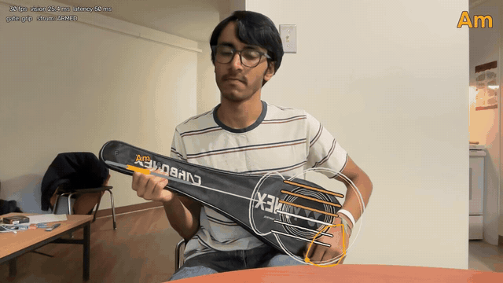

# Anystring

### No strings attached.

**Vibe strum on anything.** A tennis racket, a frying pan, a ruler: if you can hold it like
a guitar, you can play it. Just your MacBook's camera, with nothing attached to the object.



Anystring follows the object in real time, overlays six virtual strings on it, picks the
chord from where your other hand grips the handle, and plays synthesized guitar with low
latency. Click the object's four points once in the window, hold it like a guitar, and
strum. Rackets are the best-tested case, so this guide says "racket" for whatever you
pick up. The optional mic can confirm real contact with the strings.

## Why

Plenty of people see a reel and want to play guitar, and few ever do. The gap is the
friction between wanting to make music and feeling what it is like: you need a guitar,
lessons and weeks before anything sounds good. Anystring removes that first step.
Open a laptop, pick up the nearest racket (or pan, or ruler), and strum. It also shows
the chords and walks you through a song. We are not trying to replace the guitar, only to get you to one
faster. The full motivation is in [docs/motivation.md](docs/motivation.md), with the
founder's unedited words in [docs/motivation-transcript.md](docs/motivation-transcript.md).

How it works, and what we measured, is in [docs/how-we-built-it.md](docs/how-we-built-it.md).
The spec is [docs/PID.md](docs/PID.md); the architecture and repo rules are in
[CLAUDE.md](CLAUDE.md).

## Quick start

Anystring needs real hardware: a **MacBook on Apple silicon** (its camera does all the
tracking), headphones or speakers, and any **tennis or badminton racket** (or another guitar-shaped
object). There is no
web or phone version. If you cannot run it, the clip above shows it working; the
headless test suite (`uv run pytest`) needs no hardware at all.

```bash
uv sync
uv run anystring fetch-model     # one time: hand model (~7.5 MB) into models/
uv run anystring                 # click the racket's 4 points, calibrate, strum
```

Allow camera access for your terminal when macOS asks. Song mode, voice commands
and the mic gate are optional extras described below.

## Setup

You need macOS on Apple silicon, Python 3.12, [uv](https://docs.astral.sh/uv/), a
racket.

```bash
uv sync
uv run anystring fetch-model                 # MediaPipe hand model, ~7.5 MB, into models/
```

## Play

```bash
uv run anystring
```

1. **Lock on:** click the racket four times in the window, as prompted: the top of the
   head, the throat (where the head meets the shaft), where the grip starts, and the
   handle end. The app then follows the racket by optical flow on the head's rim, and
   the four chord sections are spread over the grip. Press `l` and click again whenever
   the strings stop lining up (fast moves can make it drift, and it cannot tell if you
   put the racket down).
2. **Calibrate** (first run, or `uv run anystring calibrate`): hold your **pick
   grip** over the strings exactly as you play, then **spread your strumming hand wide
   open**. Calibration is redone if the two look too alike, and is saved to
   `~/.anystring/calibration.toml`.

- **Strum:** with your pick grip (or a fist), brush across the strings, down or up.
  The badge on your hand shows ARMED. To stop, spread your fingers wide (OFF); a
  half-open hand keeps whichever state it was in.
- **Chords:** your other hand's position on the grip picks the chord: C, G, Am, F from
  the head end toward the handle end. No hand on the grip plays open strings ("no chord").
- **Mute:** rest your open strumming hand flat on the head.

Keys: `q` quit, `r` record, `c` calibrate, `g` toggle the pick-grip gate, `m` toggle
the mic gate, `l` re-lock, `d` debug view (tracked points and live grip score), `h` help.

Useful options: `--mic` (also require a contact sound from the mic, best with
headphones), `--record DIR`, `--no-audio`, `--config FILE`, `--probe-tone`.

Settings live in `~/.anystring/config.toml`; it only needs the keys you change:

```toml
[gate]
mic = true

[audio]
master_gain = 0.6
```

## Song mode

Put chord sheets in `~/.anystring/songs/` as `.txt` or `.cho` files. Either layout
works: ChordPro (`[Am]Folding paper [D]boats`) or chords on their own line above the lyric, as
chord sites show them. Add a header:

```
{title: Take On Me}
{artist: a-ha}
{tempo: 169}
{capo: 2}
```

A chord lasts one bar unless written `Am*2` (two bars) or `Am*0.5`; `{chord_bars: 0.5}`
changes the default for the whole sheet. A sheet can be chords only, one line per lyric
line; it times the same, there is just no lyric to scroll. To try song mode on a new
machine, copy the chords-only demo sheet in:

```bash
mkdir -p ~/.anystring/songs && cp examples/songs/*.txt ~/.anystring/songs/
```

Songs play at 70% of their tempo
(`--speed 1.0` for full speed). Check the timing before playing:

```bash
uv run anystring song "take on me"
```

Then play it. Press `s` and say "let's play take on me" (needs `ELEVENLABS_API_KEY`), or
pass `--song`:

```bash
uv run anystring --song "take on me"
```

A card says when the song is ready, and the handle shows its first chords, with the one
to grip highlighted in green. Say "start" (press `s` first) or press SPACE for a 3-2-1-GO
count-in. A compact overlay across the top shows the current and next chord, your
grip and lyrics that scroll upward. The active lyric is bright and prominent;
upcoming lines sit faded below it, then ease into focus when their time arrives.
The camera keeps its original size
and aspect ratio. Song cues hide during racket locking, calibration and debug view
(`d`) so those controls stay clear. Lyrics follow the sheet's tempo, even when you
stop strumming. Handle sections relabel when the song needs more than four chords.
SPACE stops and resets, "from the top" restarts, and `x` leaves song mode.

## Record a demo video

```bash
uv run anystring --demo demos/demo.mp4
```

Needs `ffmpeg` (`brew install ffmpeg`). It saves exactly what the window shows, plus the
guitar sound, as one MP4. Capture starts once you have clicked the four lock points and
stops when you quit (`q`); encoding takes a few seconds after that. The sound is the
notes you played, rendered by the same synth at their exact times, so it needs no
loopback device and has no room noise. Add `--record DIR` to also keep a replayable
session, and `--song TITLE` to play a song.

## Snap a clip (F8)

While you play, the app keeps the last 30 seconds of the window and the guitar sound in
memory. Press **F8** to save them as an MP4 in `memories/` (in the repo, git-ignored), named
`clip-YYYYMMDD-HHMMSS.mp4`. A white flash and a card in the right corner show the clip
saving, then saved; a small "F8 snap a clip" hint sits there the rest of the time. Playing
is not interrupted, and the card and hint are never in the saved video.

Needs `ffmpeg` (`brew install ffmpeg`). On a MacBook, F8 is the play/pause media key unless
you hold **Fn** (or turn on "Use F1, F2, etc. keys as standard function keys"), so `f` snaps
a clip too. Settings, in `~/.anystring/config.toml`:

```toml
[clip]
seconds = 30        # how much history F8 saves
folder = "memories" # relative paths are under the repo
jpeg_quality = 80   # the history is held as JPEGs, ~60 MB for 30 s at 720p
```

## Record and replay

`r` (or `--record DIR`) saves a session: poses, hands, onsets, notes and mic audio (a
few MB a minute). Set `[replay] video = true` to also keep lossless video for
inspecting a take; it is about 0.8 GB a minute. Replay with no camera, mic or speakers:

```bash
uv run anystring replay recordings/20261024-150000               # must match exactly
uv run anystring replay recordings/... --from-mic                # re-detect onsets
uv run anystring replay recordings/... --config try.toml --wav out.wav
```

## Measuring latency

The target is strum-to-sound p50 under 40 ms and p95 under 60 ms.

1. Run `uv run anystring --probe-tone`. Each note becomes a short 1 kHz beep.
2. Record on a phone held next to the racket while you tap or brush a string 30 or
   more times, a beat apart.
3. Run `uv run python -m tools.latency_probe analyze take.wav`.

The app also logs its own detect-to-audio time. It prints the figures when you quit;
for a recorded session, run `uv run python -m tools.latency_probe session DIR`.

## Acceptance checks

Record each on-device check with `--record DIR`, then judge the take against the PID's
targets. The take is replayed through the same play step, so silent (gate-blocked)
crossings and strum directions are counted too:

```bash
uv run python -m tools.acceptance recordings/idle-1 --check idle       # 2 min, no strumming
uv run python -m tools.acceptance recordings/strums-1 --check strums --expected 100
uv run python -m tools.acceptance recordings/burst-1 --check burst     # 8/s for 10 s
uv run python -m tools.acceptance recordings/move-1 --check move
uv run python -m tools.acceptance recordings/song-1 --check song --json song-1.json
```

Without `--check` it prints the measurements only. It exits 1 if any check fails.

## Development

```bash
uv run pytest            # headless: no camera, mic, speakers or network
uv run pytest -m hardware
uv run ruff check . && uv run ruff format .
```

## Troubleshooting

- **"could not open camera"**: allow camera access for your terminal app in System
  Settings › Privacy & Security › Camera, then restart the terminal.
- **Strings drift off the racket**: press `l` and click the four points again. Keep
  the head's rim in view; tracking follows the rim, not the string mesh.
- **Armed/off flickers**: recalibrate (`c`) in your playing position, and spread your
  fingers clearly to stop. `d` shows the live grip score against its two thresholds.
- **Mic gate misses strums**: use headphones (speaker sound leaks into the mic), and
  check the calibration screen's mic warning.
